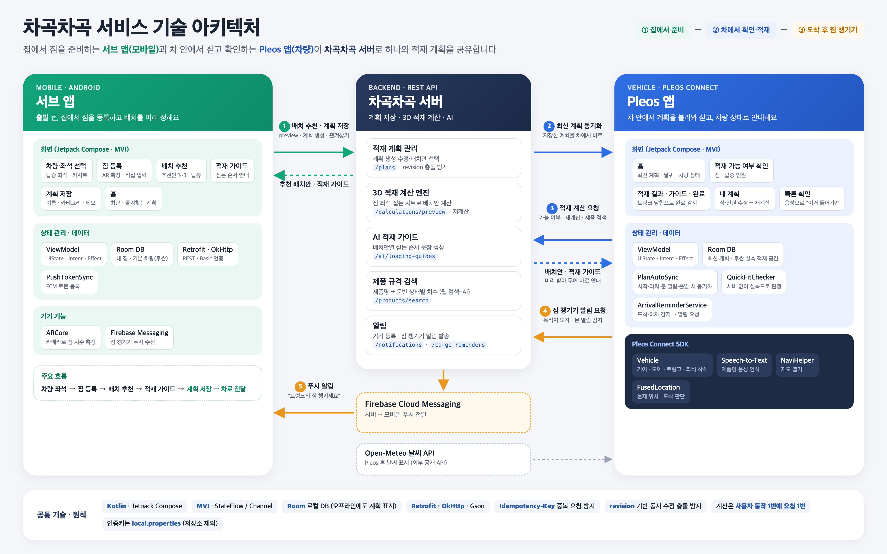
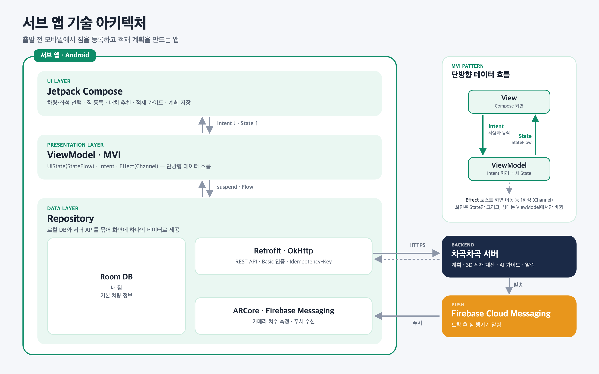

# 차곡차곡 — 서브 앱 (모바일)

> 출발 전, 집에서 짐을 등록하고 내 차에 어떻게 실을지 미리 정하는 Android 앱.
> 저장한 적재 계획은 차곡차곡 서버를 거쳐 차량의 **Pleos 앱**으로 이어집니다.

현대자동차 Pleos Connect 공모전 출품작 **차곡차곡**의 모바일 앱입니다. 1차 기준 차량은 **디 올 뉴 투싼 하이브리드(5인승 SUV)** 입니다.



## 주요 기능

| 기능 | 설명 |
|---|---|
| 차량·좌석 선택 | 탑승할 좌석을 고르면, 비어 있는 좌석과 접을 수 있는 2열을 짐 공간으로 씁니다. |
| 짐 등록 (AR 측정) | ARCore로 짐의 모서리를 찍어 가로·세로·높이를 잽니다. 수직인 선을 높이로 자동 구분하므로 재는 순서는 상관없습니다. |
| 짐 등록 (직접 입력) | 이름·수량·치수를 직접 입력합니다. |
| 배치 추천 | 서버의 3D 적재 계산으로 추천 배치안을 최대 3개까지 보여 주고, 투싼 탑뷰 위에 짐 위치를 표시합니다. |
| 적재 가이드 | 고른 배치안을 싣는 순서대로 안내합니다. 좌석을 접어야 하면 그 단계도 함께 안내합니다. |
| 계획 저장 | 이름·분류(여행·레저·이사)·메모와 함께 저장합니다. 저장한 계획은 차량 Pleos 앱에서 불러옵니다. |
| 홈 | 최근 계획과 즐겨찾는 계획을 보여 주고, 즐겨찾기를 켜고 끌 수 있습니다. |
| 짐 챙기기 알림 | 차량이 목적지에 도착하거나 문이 열리면 FCM 푸시로 "트렁크의 짐을 챙기세요"를 받습니다. |

배치가 불가능하면 조건을 바꿔 다시 추천받을 수 있습니다. 계산이 제한 시간을 넘기면(`TIME_LIMIT`) "제한 시간 안에 배치안을 찾지 못했어요"라고 따로 안내합니다.

## 기술 아키텍처



| 계층 | 구성 |
|---|---|
| UI | Jetpack Compose (Material 3) |
| Presentation | ViewModel + **MVI**: `UiState`(StateFlow) · `Intent` · `Effect`(Channel). 단방향 데이터 흐름 |
| Data | Repository → Room(내 짐·기본 차량), Retrofit·OkHttp(차곡차곡 서버) |
| 기기 기능 | ARCore(치수 측정), Firebase Cloud Messaging(푸시 수신) |

**MVI 흐름**: View가 사용자 동작을 `Intent`로 보내면, ViewModel이 처리해 새 `UiState`를 내보냅니다. 화면은 `UiState`만 그리고, 토스트·화면 이동 같은 1회성 이벤트는 `Effect`로 따로 받습니다. 상태는 ViewModel에서만 바뀝니다.

### 사용한 기술

- Kotlin 2.2 · Jetpack Compose (BOM 2026.02.01) · Material 3
- Room 2.8 · Retrofit 2.11 · OkHttp 4.12 · Gson
- ARCore 1.57
- Firebase Messaging (BOM 35.2)
- minSdk 28 · targetSdk 36 · Java 11

### 패키지 구조

```
com.windrr.hyundaesub
├─ ui/
│  ├─ home/        홈: 최근·즐겨찾는 계획
│  ├─ vehicle/     차량 선택
│  ├─ seat/        좌석 선택
│  ├─ item/        짐 선택·새 물건 안내·측정값 확인·내 물건
│  ├─ recommend/   배치 추천·적재 가이드 (탑뷰 매핑, 요청 생성)
│  ├─ result/      배치 불가·조건 변경
│  ├─ plan/        계획 저장
│  ├─ main/        화면 흐름(라우팅)·탭
│  ├─ component/   공용 버튼·다이얼로그·카드
│  └─ theme/
├─ measure/        AR 측정 화면·권한 안내·치수 계산(가로·세로·높이 판정)
├─ ar/             ARCore 렌더러·카메라 배경
├─ data/
│  ├─ local/       Room DB (내 짐·차량)
│  └─ remote/      Retrofit API·모델·Repository
└─ push/           FCM 수신·토큰 등록
```

## 서버 연동

서버는 차곡차곡 백엔드(REST)입니다. 앱이 쓰는 API는 다음과 같습니다. 전체 목록과 상태는 [`docs/API_CHECKLIST.md`](docs/API_CHECKLIST.md)에 있습니다.

| API | 쓰는 곳 |
|---|---|
| `POST /api/v1/calculations/preview` | 배치 추천 (차량 `tucson_hybrid`, 좌석 상태 포함) |
| `POST /api/v1/ai/loading-guides` | 배치안별 적재 가이드 |
| `POST /api/v1/plans` | 계획 저장 (미리보기 id + 고른 배치안) |
| `PATCH /api/v1/plans/{id}/metadata` | 이름·분류·메모, 홈 즐겨찾기 |
| `GET /api/v1/plans` | 홈 최근·즐겨찾는 계획 |
| `PUT /api/v1/notifications/devices/{id}` | FCM 토큰 등록 (짐 챙기기 알림 수신) |

요청 원칙:
- 모든 요청은 Basic 인증을 쓰고, 알림 API는 `X-Notification-Key` 헤더를 함께 보냅니다.
- 생성·변경 요청에는 `Idempotency-Key`(UUID)를 붙입니다. 새 요청이나 조건이 바뀐 요청은 새 키, 같은 요청을 재시도할 때만 같은 키를 씁니다.
- 계획 변경은 `expected_revision`으로 동시 수정 충돌을 막습니다.
- 배치 계산은 사용자 동작 한 번에 요청 한 번만 보냅니다. 조건을 바꿔 자동으로 다시 계산하지 않습니다.

차량 실측값과 서버 공간 모델은 [`docs/VEHICLE_TUCSON_HYBRID.md`](docs/VEHICLE_TUCSON_HYBRID.md)에 정리했습니다.

## 실행 방법

1. Android Studio에서 프로젝트를 엽니다.
2. 프로젝트 루트의 `local.properties`에 서버 정보를 넣습니다. 이 파일은 저장소에 올라가지 않습니다.
   ```properties
   CHAGOK_API_BASE_URL=https://<서버 주소>
   CHAGOK_API_USERNAME=<Basic 인증 아이디>
   CHAGOK_API_PASSWORD=<Basic 인증 비밀번호>
   CHAGOK_NOTIFICATION_KEY=<알림 API 키>
   ```
3. ARCore를 지원하는 기기에 설치합니다. AR 측정에는 카메라 권한과 'Google Play 서비스 AR'이 필요합니다.
   ```bash
   ./gradlew :app:installDebug
   ```

## 테스트

```bash
./gradlew :app:testDebugUnitTest
```

- **단위 테스트**: 치수 판정(`AssignDimensionsTest`·`MeasureGeometryTest`), 요청 생성(`PreviewRequestBuilderTest`), 탑뷰 매핑(`ArrangementLayoutMapperTest`), 가이드 문구(`LoadingGuideBuilderTest`) 등
- **실서버 테스트** (`*LiveTest`): `local.properties`에 서버 정보가 있을 때만 돌고, 없으면 건너뜁니다.

## 관련 문서

- [API 체크리스트](docs/API_CHECKLIST.md): 서버 API별 연결·검증 상태 (Pleos 앱과 같은 내용)
- [투싼 하이브리드 실측·공간 모델](docs/VEHICLE_TUCSON_HYBRID.md)
- [전체 서비스 구성도](docs/architecture/chagok_architecture.png) · [서브 앱 기술 아키텍처](docs/architecture/sub_architecture.png)
